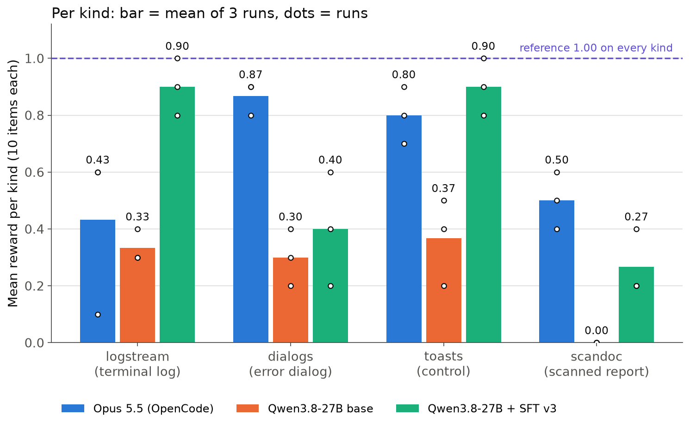
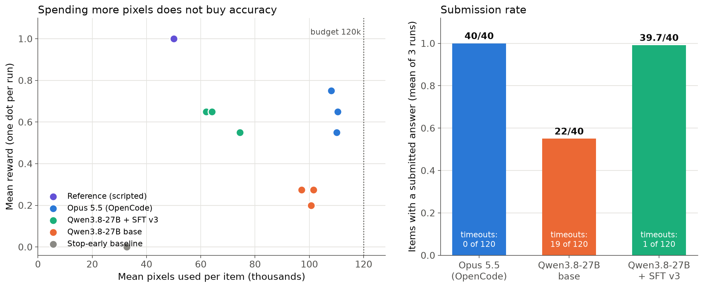
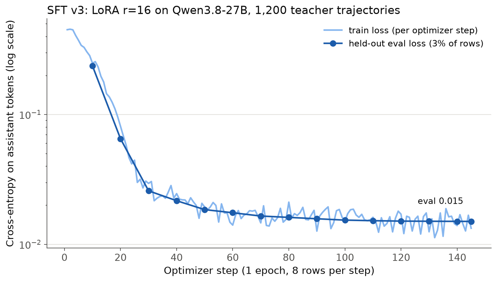

# FrameHunt

**An RL environment where the agent has to look carefully, because every pixel costs.**
Our entry to AfterQuery's "Break the Agent" challenge (Junction 2026).

The setting is triage when a recording is the only artifact: an E2E test video from
Playwright or Cypress, a user's bug-report screen recording, a terminal recording of a
failed deploy, or a long scanned report with no text layer. The agent gets one question
about it. **It can't watch the video.** Through an MCP server it can only request single
frames (or pages), optionally cropped and downscaled, and every returned pixel is charged
against a hard budget of **120,000 pixels per item**, about 6% of one 1920x1080 frame. A
request that would exceed the budget is refused.

Each answer (a request id, an error code, a toast code, an amount in a table) is random
and unreadable for a vision model at 1/4 scale or below (it needs a sharp, near-native
crop), but *when* and *where* to look can be found
cheaply: a lasting trace (a counter, a badge, page numbers and headers) is legible at
1/8 or 1/4 scale. Good play is coarse-to-fine: search the cheap trace for *when*, verify
it, then spend on one sharp crop of *where*. Being slightly off gives a confident wrong
answer: a look-alike sits one frame early, on the facing page or in the neighbouring row.
Reward is **1 for an exact answer on the first submission, else 0**.


## The agent's interface

| MCP tool | What it does | Cost |
| --- | --- | --- |
| `info()` | question, answer format, video size/fps/length, budget left, cost rules | free |
| `view(t, x, y, w, h, out_width)` | one frame, optionally cropped and downscaled | output width x height |
| `contact_sheet(t_start, t_end, n, x, y, w, h, out_width)` | a grid of n evenly spaced frames (crop applied to each) plus a frame list | n x tile pixels |
| `submit(answer)` | records the answer; only the first counts; no feedback | free |

The instruction states the question, the media facts, the budget and every cost rule. The
reference policy (`framehunt/reference.py`) is a script that uses only these tools and
scores 40/40 with about 50k pixels per item.

## The four kinds (EVAL: 40 items, 10 each)

| Kind | Setting | Question | What makes it hard |
| --- | --- | --- | --- |
| `logstream` | terminal recording of a failing service, 3-5 new log lines per second | request id of the K-th ERROR line | one frame early the (K-1)-th ERROR line is the newest; a few frames late, newer lines have pushed it up. Checking the `errors: N` counter on the exact frame costs a few hundred pixels |
| `dialogs` | desktop app, an error dialog pops up and closes (the common E2E-video case) | code shown in the K-th error dialog | the code is small; the dialog stays up for a while, so timing is forgiving |
| `toasts` (**control**) | same app, stacking toast notifications | code of the K-th red Error toast | same mechanism as logstream (lasting counter, answer briefly in the obvious spot, look-alikes before and after), but verification is cheap and co-located: the bell badge sits right above the stack |
| `scandoc` (**document**) | scanned annual report, 150-400 page images, frame index = PDF page | one amount in one note's table at a given year-end | printed page numbers are not PDF indexes (roman front matter, unnumbered inserted sheets); the comparative-year table with the same caption is on the facing page; a full page at 1/4 costs more than the budget |

All items are synthetic and generated from a seed, so the ground truth is exact. Design
details and generator guarantees: [docs/design.md](docs/design.md).

## Results

Three Opus 5.5 runs, three runs of a 27B open model before and after fine-tuning on our
environment, the scripted reference and the two baselines, all through Harbor on the same
40 EVAL items. Full tables: [docs/results/tables.md](docs/results/tables.md); data:
[docs/results/results.json](docs/results/results.json) and [results/summary.md](results/summary.md).

| Agent | Run 1 | Run 2 | Run 3 | Mean | Mean pixels / item |
| --- | --- | --- | --- | --- | --- |
| Reference (scripted, same MCP tools) | 1.000 | (deterministic) | | **1.000** | 50k (max 58k) |
| **Opus 5.5** (OpenCode 1.19.5) | 0.750 | 0.550 | 0.650 | **0.650** | 110k |
| Qwen3.8-27B base | 0.200 | 0.275 | 0.275 | **0.250** | 100k |
| Qwen3.8-27B + our SFT v3 (LoRA) | 0.650 | 0.550 | 0.650 | **0.617** | 62-74k |
| Stop-early baseline (one look, well-formed guess) | 0.000 | | | **0.000** | 33k |
| Do-nothing baseline | 0.000 | | | **0.000** | 0 |

Every Opus run is below the reference, by 10 to 18 items out of 40. Opus API cost: $16.45
for the three runs (about $0.14 per item).

Per kind (mean reward over 3 runs):

| Kind | Reference | Opus 5.5 | Qwen base | Qwen + SFT v3 |
| --- | --- | --- | --- | --- |
| logstream | 1.00 | **0.43** (0.60 / 0.10 / 0.60) | 0.33 | 0.90 |
| dialogs | 1.00 | 0.87 | 0.30 | 0.40 |
| toasts (control) | 1.00 | 0.80 | 0.37 | 0.90 |
| scandoc | 1.00 | **0.50** | 0.00 | 0.27 |



Opus spends almost the whole budget whether it is right or wrong (105.6k on correct
items, 116.8k on wrong ones); the reference needs 50k. See
[Why it's hard](#why-its-hard).

## Why it's hard

The agent has what it needs: the instruction states the question, the media facts, the
budget and every cost; the trace is visible on every frame at low resolution; every
contact sheet comes with a text list mapping tiles to frames. Every trap is visible on
screen. The reference script, which knows only the layout and fonts, scores 40/40 using
under half the budget.

We checked each of Opus's 42 failures (3 runs x 40 items) against the regenerated ground
truth and read its final message. What goes wrong is a short chain of decisions: plan the
budget, find the exact moment on the cheap trace, **verify it**, decide where to crop,
then spend on one sharp crop.

**logstream: 17 of 30 trials failed.**

1. **Reading the log before the line exists (10 of 17).** Every sharp crop of the log
   was taken before the K-th ERROR line was printed, 5 of them only 1 to 3 frames
   (0.1-0.3 s) early. At that frame the `errors:` counter still shows K-1. In 9 of the
   10, the agent had already bought a contact-sheet tile of that exact frame showing K-1
   (tiles 10-32 px tall) and misread it. In none of the 30 logstream trials did it take
   one direct look at the counter on the frame it was about to read, a check that costs
   a few hundred pixels.
2. **Right moment, wrong row (5 of 17).** Read at or after the event, but the target row
   was outside every sharp crop: new lines arrive 3-5 per second, so "the newest line"
   moves. In 4 of the 5 it submitted another line's well-formed id (DEBUG, WARN, INFO);
   in 1 it guessed. The red ERROR
   label is visible at low resolution, so locating the row first is cheap.
3. **No budget left to recover.** All 17 failures ended with under 5k pixels left (median
   330). The first sharp look at the log came after a median of 88k pixels were spent;
   the reference needs about 51k for the whole item.

**scandoc: 15 of 30 failed.** Wrong page from the printed-page vs PDF-index offset (5:
it assumed printed = PDF page +/- a constant, missing the roman front matter or an
inserted sheet); the facing comparative-year table (3, two of them the exact other-year
value of the right cell); right table, wrong row (2); digits misread at 1/3 scale (2);
budget gone before the table, then a guess (3). 14 of 15 ended with under 5k left.

**toasts, the control: 6 of 30 failed.** The mechanism is the same as logstream, but the
check is cheap and sits right above the answer. Opus checks the badge with a direct look
on the frame it reads in 10 of its 24 successes and in none of its 6 failures (4 of
which read the (K-1)-th Error toast 1-10 frames early). It scores 0.80 here vs 0.43 on
logstream. This fits the hypothesis that verification cost, not the mechanism, drives
the logstream failures; it is not proof, since layouts and distractors differ too.

**dialogs: 4 of 30 failed** (looked before the dialog opened or after it closed: 2;
crops missed the code field and it read the code at 1/3 scale: 2).

Across all kinds, 36 of 42 final messages say the agent is guessing or unsure, against
23 of 78 for correct answers, and 37 of 42 failures end with under 5k pixels left: by
the time it says it is unsure, there is no budget left to check.
Opus spends about 2x the reference even when right (106k vs 50k). The six failures that
don't hedge are mostly the traps working as designed: early toast reads, the facing
page, a wrong row.

## Training a smaller model (tiebreaker)

We fine-tuned **Qwen3.8-27B** (vision-language, served with vLLM inside the same Harbor
OpenCode agent) on trajectories from the environment's TRAIN split, which uses its own
secret salt, so no training scene is an eval scene.

- **Data** (`train/make_sft.py`): a teacher policy that perceives with the reference's
  template-matching OCR but plans with randomised coarse-to-fine choices (overview size,
  contact-sheet density, search steps, crop padding), **always verifies the event frame
  before reading**, and narrates what each returned image shows. Rows are exact OpenCode
  1.19.5 requests (captured system prompt, 17 tools, image messages). Only trajectories
  the server marked correct are kept. v2: 900 trajectories (300 each of logstream,
  dialogs, toasts); v3: 1,200, including scandoc.
- **Training** (`train/sft_lora.py`): LoRA r=16 on the language model's attention and MLP,
  vision tower frozen, loss on assistant tokens only. v3: 1 epoch, 145 optimizer steps,
  lr 1e-4, on 4xH100 (DDP); held-out eval loss 0.015.
- **Evaluation**: the same Harbor tasks and OpenCode agent; base and fine-tuned models
  served identically (vLLM, one H100 per run, 15 concurrent trials, fp8 KV cache).

| | Qwen base | + SFT v2 (30 items, no scandoc) | **+ SFT v3** |
| --- | --- | --- | --- |
| Mean reward | 0.250 (0.200 / 0.275 / 0.275) | 0.611 (0.700 / 0.500 / 0.633) | **0.617** (0.650 / 0.550 / 0.650) |
| Answers submitted | 18 / 25 / 23 of 40 | 30 / 30 / 30 of 30 | 40 / 39 / 40 of 40 |
| Agent timeouts (1800 s) | 19 of 120 trials | 0 of 90 | 1 of 120 |
| Mean pixels per item | 97-102k | 56-63k | 62-74k |

The fine-tuned model goes from 0.25 to 0.62, close to Opus (0.65), and on logstream it
beats Opus (0.90 vs 0.43), the kind where the teacher's always-verify-then-read plan
matters most.
It submits on almost every item instead of running out of time, and spends about two
thirds of the pixels the base model does (67k vs 100k per item). It remains weaker than Opus on dialogs (0.40) and scandoc
(0.27), where reading small text at the right crop matters more than the search plan.




Caveats: the scandoc training rows used the video tools' descriptions (a small train/eval
mismatch). An RL stage (GRPO on the binary reward) is in progress on a separate branch.
Details: [train/README.md](train/README.md), [infra/verda/README.md](infra/verda/README.md).

## How it's scored, and why the reward holds up

- **Binary reward**: 1.0 only if the first submitted answer matches exactly (ignoring
  case and whitespace). No partial
  credit, no shaping term to farm. The budget is a hard constraint, not a reward term.
- **Separate verifier**: the MCP server runs in an `fh-mcp` sidecar container. After the
  agent finishes, a hook dumps the server's own record (submitted answer, correctness,
  pixels, every call) through a token-protected route. Harbor copies it into a separate
  verifier container (no network) that writes `/logs/verifier/reward.txt`. Nothing the
  agent's container writes is read.
- **No feedback**: `submit` never says whether the answer was right; only the first
  submission counts, so guessing repeatedly doesn't help.
- **Secret instances**: generators and item ids are public, but each item's seed is
  `HMAC(salt, split:item)` with a secret per-checkout salt (`secrets/eval.salt`, created
  on the first build, git-ignored). A fresh checkout gets new instances of the same
  kinds and difficulty, so answers can't be precomputed offline from the public
  generators without that checkout's salt (and the agent never sees it).
- **Baselines score 0**: do-nothing 0/40; stop-early (one cheap look, then a well-formed
  guess of the right format) 0/40. Look-alikes are all well-formed, so format alone
  earns nothing.
- Tests: `tests/test_antihack.py`, `tests/test_integrity.py` (verifier strictness,
  missing/symlinked evidence, token checks, no secrets in the sidecar image).

## Run the evaluation (one command)

Requirements: Docker, [uv](https://docs.astral.sh/uv/), Harbor 0.25.0
(`uv tool install 'harbor==0.25.0'`), and `ANTHROPIC_API_KEY` in the environment or in
`.env` for the agent runs.

```bash
scripts/eval.sh
```

This builds the 40 EVAL tasks (a fresh checkout creates its own secret salt on the first
build) and runs, through Harbor:

| Stage | Harbor job (`runs/<job>`) | What it is |
| --- | --- | --- |
| build | - | `scripts/build_tasks.py --split eval` writes `tasks/eval/<item>/` |
| reference | `fh-eval-reference` | Harbor's `oracle` agent runs `solution/solve.sh`: the scripted policy, MCP tools only |
| do-nothing | `fh-eval-nop` | Harbor's `nop` agent; never submits |
| stop-early | `fh-eval-stop-early` | `framehunt/baselines/stop_early.py`: `info`, one low-res look, a well-formed guess |
| agents | `fh-eval-opencode-run1..3` | `harbor run -a opencode -m anthropic/claude-opus-5-5`, three runs |
| summary | - | `scripts/summarize.py` writes `results/summary.md` and `results/summary.json` |

On local Docker at the default `-n 4` this takes several hours (each 40-item stage is
roughly 5-25 min, each Opus run about 45-60 min) and about $17 of API credits; use
`--runs 1` for a single agent run (~$5.5). To run every job on **Modal** instead (no local load,
much faster):

```bash
uv tool install --force 'harbor[modal]==0.25.0'
export MODAL_TOKEN_ID=... MODAL_TOKEN_SECRET=...
scripts/eval.sh --env modal -n 40
```

**Checked on a fresh clone** (2026-11-14, `scripts/eval.sh --env modal -n 40 --runs 1`,
new salt, so new instances): the whole pipeline took 14 min (build 5 s, reference 139 s,
do-nothing 132 s, stop-early 327 s, one Opus run 241 s, summary) and $5.72 of API.

| Fresh clone | Score | Per kind (logstream / dialogs / toasts / scandoc) | Mean pixels |
| --- | --- | --- | --- |
| Reference | 1.000 (40/40) | 1.0 / 1.0 / 1.0 / 1.0 | 50k |
| Do-nothing | 0.000 | | 0 |
| Stop-early | 0.000 | | 32k |
| Opus 5.5, one run | 0.700 (28/40) | 0.5 / 0.6 / 1.0 / 0.7 | 109k |

One stop-early trial hit a Modal Docker-in-Docker build error before the agent started
(scored 0, like every stop-early trial). The default local-Docker path was also smoke-tested
from the same clone on 3 items at `-n 2` (reference 3/3, do-nothing 0, stop-early 0,
Opus 2/3). With one Opus run, expect run-to-run spread: our three runs ranged 0.55-0.75.

Parts and options:

```bash
scripts/eval.sh --stage baselines   # build + reference + nop + stop-early (no API spend)
scripts/eval.sh --stage agents      # only the agent runs (uses API credits)
scripts/eval.sh --stage summarize   # rebuild the summary from runs/
scripts/eval.sh --runs 1 -n 8       # one agent run, 8 concurrent trials
```

### Other models and providers

`--model <provider/model>` is passed to `harbor run -a opencode -m <provider/model>`
(OpenCode pinned to 1.19.5). The script forwards only `ANTHROPIC_API_KEY` to the agent.
For another hosted provider, run Harbor directly with an env file holding that
provider's key under the name OpenCode expects:

```bash
harbor run -p tasks/eval -a opencode -m <provider/model> --ak version=1.19.5 \
  --env-file <file with the provider key> --job-name fh-eval-<name>-run1 -o runs -n 4 -y
```

Qwen3.8-27B (base or with our adapter) runs on our own vLLM endpoints, one Verda H100
per run (`infra/verda/README.md`; needs Verda keys):

```bash
scripts/eval.sh --stage agents --model qwen --fleet                            # base, 3 runs in parallel
scripts/eval.sh --stage agents --model qwen-fh --lora train/out/<run> --fleet  # with a LoRA adapter
```

### Harness details

- Each item is a Harbor task (`tasks/eval/<item>/`: `instruction.md`, `task.toml`,
  `environment/docker-compose.yaml`, `solution/`, `tests/`).
- Multi-container Docker Compose: the agent's `main` container plus the `fh-mcp` sidecar
  serving MCP at `http://fh-mcp:8000/mcp`. The agent container has public network
  access (for its model API); the sidecar holds the seed, the agent never sees it.
- Agent timeout 1800 s (`[agent] timeout_sec`). Only agent-install timeouts are retried
  (before the agent sees anything); any later failure counts as a failure.
- Verifier: `[verifier] environment_mode = "separate"`, writes 0/1 to
  `/logs/verifier/reward.txt`.
- Runs on local Docker (default) or Modal (`--env modal`, Docker-in-Docker inside a
  Modal sandbox).

### Reproducibility

- A fresh checkout generates a fresh salt, so judges get **new instances** of the same
  40 item ids: same generators, same distributions over kinds, K, event times and
  layouts. Our numbers come from our salt; expect the same picture, not the same
  per-item outcomes. The reference is deterministic given the salt; it scored 40/40 on
  our salt and on a fresh clone's salt, and the tests run it on 100-200 random seeds
  each of toasts, leaderboard and scandoc.
- Our runs: reference, baselines, Qwen base and all SFT runs, and Opus's 10 scandoc
  trials used the current salt. Opus's 30 video trials ran under the previous EVAL v2
  salt: we rotated it after a summary that included answers was accidentally pushed
  (summaries no longer contain answers). Same generators and items, new instances.
- Base Qwen reruns kept 14 trials that had finished validly before an infrastructure
  network failure; trials lost to infrastructure (Docker network pool exhaustion, a
  relay outage) were rerun and never counted. The 1800 s timeout means serving speed
  matters for Qwen; base and fine-tuned used identical serving.
- Every Harbor job is logged under `runs/<job>/` (config, per-trial result, the
  server's call log, the agent's trajectory). `scripts/summarize.py` rebuilds the
  tables from those folders.

## Example run logs

[examples/harbor-runs/](examples/harbor-runs/) holds full Harbor job outputs with
scores (`result.json`, per-trial `verifier/reward.txt`, the MCP server's call log, the
agent's trajectory):

- `fresh-clone-modal-opus-run1/`: Opus 5.5 on the 40 current EVAL item ids from the
  fresh-clone check above (throwaway salt), score 0.700 (28/40).
- `fh-eval-opencode-run1/`: Opus 5.5 run 1 on the **EVAL v1** set (30 items, retired
  salt), score 0.700 (21/30).

Neither salt is the one behind our reported results, so publishing their answers is safe.

## History: EVAL v1

The first EVAL set had 30 items (10 each of logstream, dialogs and a `dashboard` kind).
Opus 5.5 scored 0.70 in all three runs (logstream 3, 3, 4 of 10); Qwen base 0.27 / 0.13 /
0.20 (under heavier serving contention). Dashboard was too easy (Opus 29/30 over three
runs), so EVAL v2 replaced it with the toasts control and the scandoc document kind.
Rebuild v1 with `scripts/build_tasks.py --split eval --v1`.

## Repository map

| Path | What |
| --- | --- |
| `framehunt/scenes/` | scene generators: `logstream`, `dialogs`, `toasts`, `scandoc` (EVAL); `dashboard`, `leaderboard` (DEV/TRAIN) |
| `framehunt/server.py` | the MCP server: tools, budget, evidence routes |
| `framehunt/reference.py` | the scripted reference policy |
| `framehunt/baselines/` | the stop-early baseline agent |
| `framehunt/splits.py` | EVAL, EVAL_V1, DEV, TRAIN item lists; seed derivation |
| `framehunt/verify.py`, `evidence.py` | the verifier and the sidecar's evidence dump |
| `scripts/eval.sh` | the one command; `build_tasks.py`, `summarize.py` |
| `results/` | our summary (`summary.md`, `summary.json`, `stage_times.txt`) |
| `docs/results/` | deck material: charts, `tables.md`, `results.json`, `make_results.py` |
| `docs/design.md` | item rules, generator guarantees, interfaces, reward integrity, budget choice |
| `docs/framing.md` | pitch framing for the demo |
| `train/` | SFT data generation and LoRA training (see `train/README.md`) |
| `infra/verda/` | Qwen serving, training and parallel evals on Verda GPUs |
| `tests/` | `uv run pytest -m "not reference"`; `uv run pytest -m reference -s` runs the reference on all 40 EVAL items and on random seeds |
