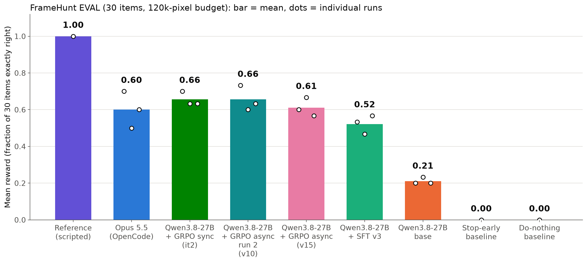

# FrameHunt

An RL environment where every pixel the agent looks at costs budget. Our entry to
AfterQuery's "Break the Agent" challenge (Junction 2026).

The agent gets one question about a recording: an E2E test video, a bug-report screen
recording, a terminal recording of a failed deploy, or a long scanned report with no
text layer. **It can't watch the video.** Through MCP tools it requests single frames
(or pages), optionally cropped and downscaled. Every returned pixel counts against a hard
budget of **120,000 pixels per item**, about 6% of one 1920x1080 frame.

The answer is random and needs a sharp, near-native crop to read. A vision model can't
read it at 1/4 scale or below. *When* and *where* to look can be found cheaply, because
a lasting trace (a counter, a badge, page numbers) is legible at 1/8 or 1/4 scale. Good
play: search the trace for *when*, verify it, then spend on one sharp crop of *where*.
Being slightly off gives a confident wrong answer, because a look-alike sits one frame
early, on the facing page or in the next row.

**Reward:** 1 for an exact answer on the first submission, else 0.

| Tool | Does | Cost |
| --- | --- | --- |
| `info()` | question, answer format, media facts, budget left, cost rules | free |
| `view(t, x, y, w, h, out_width)` | one frame, optionally cropped and downscaled | output width x height |
| `contact_sheet(t_start, t_end, n, ...)` | grid of n evenly spaced frames, with a frame list | n x tile pixels |
| `submit(answer)` | first submission counts; no feedback | free |

A request that costs more than the remaining budget is refused and charges nothing.

## Why this setting

Agents that work on screens, recordings and long documents pay for everything they look
at: each image costs tokens and stays in the context for the rest of the task. Choosing
when, where and at what resolution to look is part of ordinary agent work, such as
checking an E2E test video or finding one figure in a 300-page scan, and few environments
train it.

FrameHunt isolates that skill. An agent can learn here to plan a budget before the first
look, find the moment on a cheap low-resolution trace, confirm it with a look that costs
a few hundred pixels, and then spend on one sharp crop. The skill is learnable: training
a 27B open model on the environment raised its score from 0.21 to 0.66 (see Results).

## The three kinds (EVAL: 30 items, 10 each)

- **logstream**: a terminal log scrolls 3-5 lines per second; give the request id of the K-th ERROR line.
- **dialogs**: an error dialog pops up and closes in a desktop app; give its code.
- **scandoc**: a 150-400 page scanned annual report; find one amount in one note's table.

## Results

All runs go through Harbor on the same 30 EVAL items.

| Agent | Run 1 | Run 2 | Run 3 | Mean | Mean pixels / item |
| --- | --- | --- | --- | --- | --- |
| Reference (scripted, same MCP tools) | 1.000 | | | **1.000** | 53k (max 58k) |
| **Opus 5.5** (OpenCode 1.19.5) | 0.700 | 0.500 | 0.600 | **0.600** | 113k |
| Qwen3.8-27B base | 0.200 | 0.233 | 0.200 | **0.211** | 94k |
| Qwen3.8-27B + our SFT v3 (LoRA) | 0.533 | 0.467 | 0.567 | **0.522** | 75k |
| Qwen3.8-27B + SFT v3 + our GRPO (RL, sync it2) | 0.700 | 0.633 | 0.633 | **0.656** | 82k |
| Stop-early baseline (one look, well-formed guess) | 0.000 | | | **0.000** | 33k |
| Do-nothing baseline | 0.000 | | | **0.000** | 0 |

- Every Opus run is below the reference, by 9 to 15 items out of 30. The three runs
  cost $12.92 in API fees (about $0.14 per item).
- The reference is a deterministic script that plays through the same MCP tools, so it
  has one run. It also scored 30/30 on the new instances of a fresh clone.
- Opus is weakest on logstream (0.43) and scandoc (0.50); on dialogs it scores 0.87.
- Opus spends almost the whole budget whether it is right or wrong (108.9k on correct
  items, 118.9k on wrong ones). The reference needs 53k.
- Training Qwen3.8-27B on our environment raised it from 0.21 (base) to 0.52 with SFT
  on teacher trajectories, then to 0.66 with GRPO on the environment's own reward. Every
  GRPO sync run beats every SFT v3 run. GRPO's gain is on dialogs (12 to 20 correct of 30) and
  scandoc (8 to 13).
- The GRPO model's mean is above Opus's 0.600, but the run ranges overlap, so the fair
  reading is that it reaches Opus's level. Details: [docs/training.md](docs/training.md).
- Opus's logstream and dialogs trials ran on earlier instances of the same item ids (a
  previous salt, same generators and distributions). Every other number in the table is
  on the current instances. See [docs/running.md](docs/running.md#reproducibility).



## Where Opus fails

Opus failed 36 of its 90 trials. We checked each failure against the regenerated ground
truth and read the agent's final message.

| Kind | Failed | Mistakes |
| --- | --- | --- |
| logstream | 17 of 30 | 10: every sharp crop of the log was taken before the K-th ERROR line was printed, 5 of them only 0.1-0.3 s early. 5: read at the right time, but the target row was outside every sharp crop. |
| scandoc | 15 of 30 | 5: wrong page, assuming a constant offset between printed page numbers and PDF indexes (roman front matter and inserted sheets break it). 3: read the facing comparative-year table. 3: budget gone before reaching the table. 2: right table, wrong row. 2: digits misread at 1/3 scale. |
| dialogs | 4 of 30 | 2: looked before the dialog opened or after it closed. 2: crops missed the code field. |

The decision behind most of these is whether to verify before the expensive look:

- On logstream, the `errors: N` counter on the frame the agent is about to read shows
  whether the K-th ERROR line exists yet. Looking at it costs a few hundred pixels. Opus
  did not take that look in any of its 30 logstream trials. In 9 of the 10 too-early
  failures it had already bought a contact-sheet tile of that exact frame showing K-1.
- Opus spends early and has nothing left to check with. In the logstream failures its
  first sharp look at the log came after a median of 88k pixels; the reference needs
  about 51k for the whole item. 34 of 36 failures end with under 5k pixels left.
- Opus knows when it is unsure: 32 of the 36 failures end with a final message saying it
  is guessing or unsure, against 16 of its 54 correct answers.

The agent has what it needs to do better. `info()` states the question, the media facts,
the budget and the cost of every call. The trace is visible on every frame at low
resolution, every contact sheet comes with a text list that maps each tile to its frame,
and every trap is visible on screen. The reference plays through the same tools, knows
only the screen layout and the fonts, and uses less than half the budget. Full analysis:
[docs/why-its-hard.md](docs/why-its-hard.md).

## Reward integrity

- The reward is 1 only if the first submitted answer matches exactly, ignoring case and
  whitespace. There is no partial credit and no shaping term. `submit` gives no feedback, so guessing again earns nothing.
- The pixel budget is a hard limit and earns no reward of its own, so spending little
  scores nothing.
- The MCP server runs in a sidecar container and keeps its own record of the submission.
  A separate verifier container with no network writes the reward from that record.
  Nothing the agent's container writes is read.
- Generators and item ids are public. Each item's seed is `HMAC(salt, split:item)` with
  a secret salt created per checkout, so answers can't be computed from the public code.
- Do-nothing scores 0/30. Stop-early (one cheap look, then a guess in the right format)
  also scores 0/30, because every look-alike is well-formed too.

Details and tests: [docs/scoring-and-integrity.md](docs/scoring-and-integrity.md).

## Run the evaluation

Requirements: Docker, [uv](https://docs.astral.sh/uv/), Harbor 0.25.0
(`uv tool install 'harbor==0.25.0'`), and `ANTHROPIC_API_KEY` in the environment or in
`.env`.

```bash
scripts/eval.sh
```

This builds the 30 tasks, then runs the reference, the do-nothing and stop-early
baselines and three Opus runs, and writes `results/summary.md`. On local Docker it takes
several hours. The three Opus runs cost about $13 of API credits. On Modal it is much
faster:

```bash
uv tool install --force 'harbor[modal]==0.25.0'
export MODAL_TOKEN_ID=... MODAL_TOKEN_SECRET=...
scripts/eval.sh --env modal -n 30
```

A fresh checkout creates its own secret salt, so it builds new instances of the same 30
items. Expect the reference at 30/30, both baselines at 0 and each Opus run in the range
of ours (0.50 to 0.70), with different per-item outcomes. We checked this from a fresh
clone on Modal with one Opus run (`--runs 1`): reference 30/30, both baselines 0, Opus
18/30 (0.600) on the 30 current items. Details, options, other models and harness notes:
[docs/running.md](docs/running.md).

## More

| Doc | What's in it |
| --- | --- |
| [docs/why-its-hard.md](docs/why-its-hard.md) | each kind's trap; analysis of all 36 Opus failures |
| [docs/results/tables.md](docs/results/tables.md) | full tables, per kind, pixels, EVAL v1 history; charts and `results.json` in [docs/results/](docs/results/) |
| [docs/scoring-and-integrity.md](docs/scoring-and-integrity.md) | the reward, the separate verifier, secret instances, baselines |
| [docs/training.md](docs/training.md) | training Qwen3.8-27B (tiebreaker): SFT, then GRPO; method, results, caveats |
| [docs/running.md](docs/running.md) | the one command in detail, Modal, other models, harness, reproducibility |
| [docs/design.md](docs/design.md) | full spec: item rules, generators, interfaces, budget choice |
| [examples/harbor-runs/](examples/harbor-runs/) | full Harbor logs of two Opus runs on other instances: the fresh-clone check and an EVAL v1 run |

## Repository map

| Path | What |
| --- | --- |
| `framehunt/scenes/` | scene generators: `logstream`, `dialogs`, `scandoc` (EVAL); `dashboard`, `toasts`, `leaderboard` (DEV/TRAIN); `mathanim` (DEV, a ManimCE animation rendered at build time) |
| `framehunt/server.py` | the MCP server: tools, budget, evidence routes |
| `framehunt/reference.py` | the scripted reference policy |
| `framehunt/baselines/` | the stop-early baseline agent |
| `framehunt/splits.py` | EVAL, EVAL_V1, DEV, TRAIN item lists; seed derivation |
| `framehunt/verify.py`, `evidence.py` | the verifier and the sidecar's evidence dump |
| `scripts/eval.sh` | the one command; also `build_tasks.py`, `summarize.py` |
| `results/` | our run summary (`summary.md`, `summary.json`, `stage_times.txt`) |
| `docs/results/` | charts, `tables.md`, `results.json`, `make_results.py` |
| `train/` | SFT data and LoRA training; GRPO losses and rollout conversion ([train/README.md](train/README.md)) |
| `infra/verda/` | Qwen serving, training and parallel evals on Verda GPUs; `grpo/`, `grpo_async/` RL loops |
| `tests/` | `uv run pytest -m "not reference"`; `uv run pytest -m reference -s` runs the reference on all 30 EVAL items and on random seeds |
