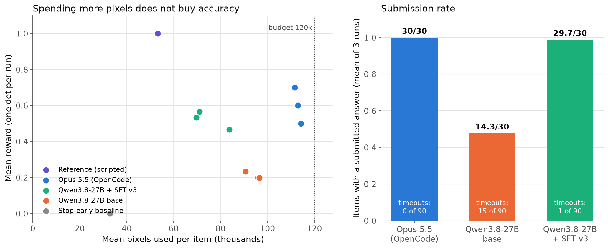

# Training a smaller model (tiebreaker)

We fine-tuned **Qwen3.8-27B**, a vision-language model, on trajectories from
FrameHunt's TRAIN split. TRAIN has its own secret salt, so no training scene is an eval
scene. The fine-tuned model runs in the same Harbor OpenCode agent as Opus, served by
vLLM.

## Results

On the 30 EVAL items, 3 runs each:

| | Qwen base | **+ SFT v3** |
| --- | --- | --- |
| Mean reward | 0.211 (0.200 / 0.233 / 0.200) | **0.522** (0.533 / 0.467 / 0.567) |
| Answers submitted | 13 / 16 / 14 of 30 | 30 / 29 / 30 of 30 |
| Agent timeouts (1800 s) | 15 of 90 trials | 1 of 90 |
| Mean pixels per item | 91-96k | 70-84k |

Per kind (mean reward over 3 runs):

| Kind | Qwen base | + SFT v3 | Opus 5.5 |
| --- | --- | --- | --- |
| logstream | 0.33 | **0.90** | 0.43 |
| dialogs | 0.30 | 0.40 | 0.87 |
| scandoc | 0.00 | 0.27 | 0.50 |

- The score goes from 0.21 to 0.52. Opus scores 0.60.
- On logstream the fine-tuned model beats Opus, 0.90 vs 0.43. That is the kind where the
  teacher's always-verify-then-read plan matters most.
- It submits on almost every item instead of running out of time.
- It uses about 80% of the base model's pixels (75k vs 94k per item).
- It stays weaker than Opus on dialogs (0.40) and scandoc (0.27), where reading small
  text from the right crop matters more than the search plan.

An earlier adapter, SFT v2, was trained without scandoc data and run on the 30 items
EVAL had then (logstream, dialogs, toasts). Rescored on its 20 logstream and dialogs
items: 0.650 / 0.550 / 0.650 (mean 0.617), logstream 0.77,
dialogs 0.47, every item submitted, no timeouts, 65-72k pixels per item.

## Data

`train/make_sft.py` runs a teacher policy:

- It perceives with the reference's template-matching OCR.
- It plans with randomised coarse-to-fine choices (overview size, contact-sheet
  density, search steps, crop padding).
- It **always verifies the event frame before reading**.
- It narrates what each returned image shows.

Each row is an exact OpenCode 1.19.5 request (captured system prompt, 17 tools, image
messages). Only trajectories the server marked correct are kept.

- v2: 900 trajectories, 300 each of logstream, dialogs and toasts.
- v3: 1,200 trajectories, including scandoc.

## Training

`train/sft_lora.py`: LoRA r=16 on the language model's attention and MLP layers. The
vision tower is frozen and the loss covers assistant tokens only. v3 ran 1 epoch (145
optimizer steps) at lr 1e-4 on 4xH100 with DDP. Held-out eval loss: 0.015.

## Evaluation

Same Harbor tasks, same OpenCode agent. Base and fine-tuned models were served the same
way: vLLM, one H100 per run, 15 concurrent trials, fp8 KV cache.

## Caveats

- The scandoc training rows used the video tools' descriptions, a small mismatch with
  the eval tasks.
- An RL stage (GRPO on the binary reward) is in progress on a separate branch.

Full details: [train/README.md](../train/README.md) and
[infra/verda/README.md](../infra/verda/README.md).
