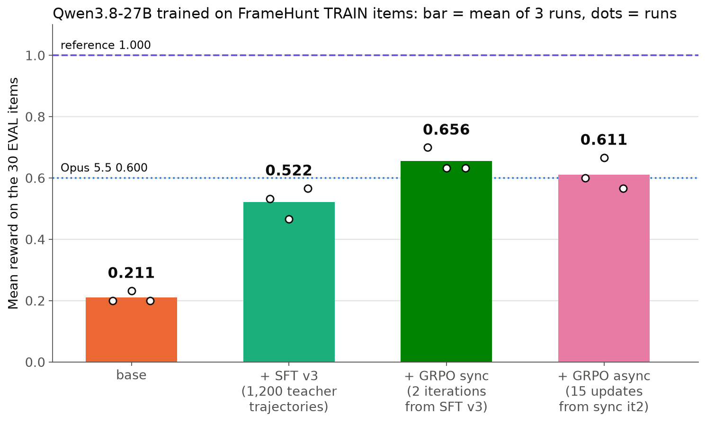
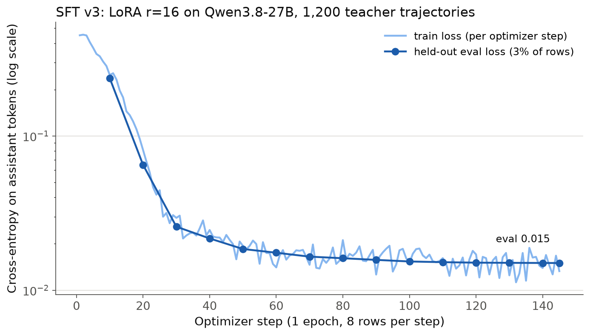
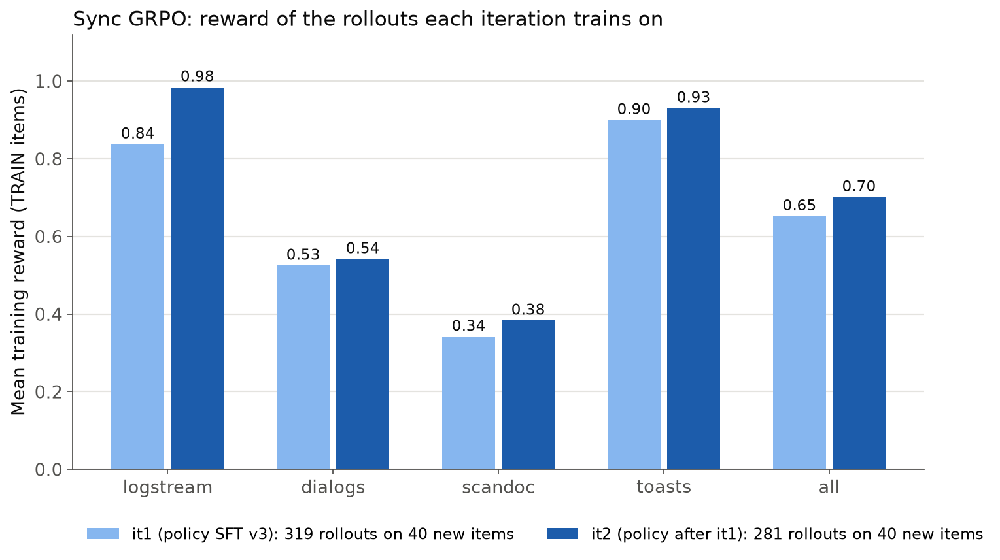

# Training a smaller model (tiebreaker)

We trained **Qwen3.8-27B**, a vision-language model, on experience from FrameHunt's TRAIN
split in two stages: supervised fine-tuning (SFT) on teacher trajectories, then
reinforcement learning (GRPO) on the environment's own reward. TRAIN has its own secret
salt, so no training scene is an eval scene. Every trained model runs in the same Harbor
OpenCode agent as Opus, served by vLLM.

## Results

On the 30 EVAL items, 3 runs each:

| | Qwen base | + SFT v3 | **+ GRPO sync (it2)** | + GRPO async (v15) |
| --- | --- | --- | --- | --- |
| Starts from | | base | SFT v3 | GRPO sync it2 |
| Mean reward | 0.211 | 0.522 | **0.656** | 0.611 |
| Runs | 0.200 / 0.233 / 0.200 | 0.533 / 0.467 / 0.567 | 0.700 / 0.633 / 0.633 | 0.600 / 0.667 / 0.567 |
| Correct, logstream (of 30) | 10 | 27 | 26 | 26 |
| Correct, dialogs (of 30) | 9 | 12 | 20 | 18 |
| Correct, scandoc (of 30) | 0 | 8 | 13 | 11 |
| Answers submitted (of 90) | 43 | 89 | 86 | 79 |
| Agent timeouts (1800 s) | 15 of 90 | 1 of 90 | 1 of 90 | 1 of 90 |
| Mean pixels per item | 91-96k | 70-84k | 79-85k | 78-80k |

- SFT takes Qwen from 0.21 to 0.52. GRPO on top of SFT takes it to 0.66.
- **Every GRPO sync run beats every SFT v3 run**: 21, 19 and 19 correct against 16, 14
  and 17.
- GRPO's gain is on the two kinds SFT left weak. Dialogs go from 12 to 20 correct of 30,
  scandoc from 8 to 13. Logstream, already at 27 after SFT, stays about the same (26).
- Opus 5.5 scores 0.600 (runs 0.700 / 0.500 / 0.600). GRPO sync's mean, 0.656, is
  higher, but the run ranges overlap, the difference is 5 correct answers out of 90, and
  Opus's 20 logstream and dialogs items ran on different instances of the same item ids
  (the previous EVAL salt; same generators and distribution, see
  [running.md](running.md#reproducibility)). So the fair reading is: the 27B model,
  trained only on TRAIN items, reaches Opus's level on this task. It does not clearly
  beat it.
- The async continuation scored lower than the sync adapter it started from (0.611 vs
  0.656). Reasons are below.

An earlier adapter, SFT v2, was trained without scandoc data and run on the 30 items
EVAL had then (logstream, dialogs, toasts). Rescored on its 20 logstream and dialogs
items: 0.650 / 0.550 / 0.650 (mean 0.617), logstream 0.77, dialogs 0.47, every item
submitted, no timeouts, 65-72k pixels per item.

Full tables: [results/tables.md](results/tables.md).

## Stage 1: SFT on teacher trajectories

### Data

`train/make_sft.py` runs a teacher policy:

- It perceives with the reference's template-matching OCR.
- It plans with randomised coarse-to-fine choices (overview size, contact-sheet
  density, search steps, crop padding).
- It **always verifies the event frame before reading**.
- It narrates what each returned image shows.

Each row is an exact OpenCode 1.19.5 request (captured system prompt, 17 tools, image
messages). Only trajectories the server marked correct are kept.

- v2: 900 trajectories, 300 each of logstream, dialogs and toasts.
- v3: 1,200 trajectories (TRAIN items 1-300 of each kind), including scandoc.

### Training

`train/sft_lora.py`: LoRA r=16 on the language model's attention and MLP layers. The
vision tower is frozen and the loss covers assistant tokens only. v3 ran 1 epoch (145
optimizer steps) at lr 1e-4 on 4xH100 with data parallel (`torchrun`, see
[train/README.md](../train/README.md#several-gpus-on-one-box-data-parallel)). Held-out
eval loss: 0.015.

### What SFT did and did not fix

- On logstream SFT alone reaches 0.90, against Opus's 0.43. That is the kind where the
  teacher's always-verify-then-read plan matters most.
- The model submits on almost every item instead of running out of time.
- It stays weak on dialogs (0.40) and scandoc (0.27), where reading small text from the
  right crop matters more than the search plan. Our guess is that imitation copies the
  plan but not the judgment of where exactly to crop. The RL stage lets the model learn
  from its own hits and misses on exactly those choices.

## Stage 2: GRPO on the environment's reward

GRPO (group relative policy optimization) learns from the model's own attempts. For each
TRAIN item the current model plays the task 8 times through the real environment, and
the verifier scores each attempt 1 or 0, exactly as in the eval. Attempts that beat their
group's average are made more likely, those below it less likely.

### Method

1. **Rollouts.** vLLM serves the current LoRA adapter. Harbor runs the same OpenCode
   agent and the same MCP server and verifier as the eval, with G = 8 attempts per item.
   A logging relay ([infra/verda/log_relay.py](../infra/verda/log_relay.py)) records
   every request and response, so each attempt becomes a training row with the exact
   tokens the model produced.
2. **Advantages.** [train/rollouts_to_pg.py](../train/rollouts_to_pg.py) turns every
   attempt, right or wrong, into a row with advantage A = (reward - group mean) / group
   std. Groups where all 8 attempts score the same carry no signal and are dropped. An
   agent timeout counts as reward 0. Harness failures (setup or verifier errors) are left
   out of their group. A few attempts whose logged conversation can't be turned into an
   exact training row (for example, OpenCode rewrote the history) still count in their
   group's mean but get no row: 10 of 281 in it2.
3. **Update.** `train/sft_lora.py --pg` continues the LoRA from the current adapter with
   an advantage-weighted policy-gradient loss on assistant tokens: rows with A > 0 are
   pushed up, rows with A < 0 pushed down. lr 2e-5 (constant), LoRA r=16, dropout 0, one
   pass over the rows, data parallel on 7 H100s.

Each iteration uses **40 TRAIN items it has never seen**: 10 each of logstream,
dialogs, scandoc and toasts (toasts is a TRAIN-only kind). They are never the 1-300
items used for SFT and never repeat across iterations. So a rising training reward
can't come from memorizing items. It is still measured on a different sample each
time; the evidence that the model improved is the EVAL score. No EVAL item is ever used
in training.

### Sync GRPO: 2 iterations

Code: [infra/verda/grpo/](../infra/verda/grpo/) (`iterate.sh` runs one iteration,
`loop.sh` chains them).

| Iteration | Policy that played | Rollouts | Groups with signal | Rows (A>0 / A<0) | Steps | Training reward |
| --- | --- | --- | --- | --- | --- | --- |
| it1 | SFT v3 | 319 | 33 of 40 | 263 (152 / 111) | 8 | 0.652 |
| it2 | after it1 | 281 | 22 of 36 | 166 (101 / 65) | 8 | **0.701** |

The reward went up on every kind between iterations, on new items: logstream 0.84 to
0.98, dialogs 0.53 to 0.54, scandoc 0.34 to 0.38, toasts 0.90 to 0.93. The it2 adapter
is the one we report as "GRPO sync". A third iteration was started but stopped to give
the GPUs to the async run.

### Async GRPO: 15 updates from sync it2

Code: [infra/verda/grpo_async/](../infra/verda/grpo_async/) and
[train/async_grpo.py](../train/async_grpo.py).

In the sync loop the GPUs that train sit idle during rollouts, and vice versa. The async
version (in the style of PipelineRL) removes that barrier:

- Dedicated inference GPUs run vLLM permanently and hot-load each new adapter at
  runtime, without a restart.
- A scheduler keeps rollouts running continuously, one 8-attempt group per new TRAIN
  item (items 401 onward, again never seen).
- The relay records the behaviour log-probabilities of every generated token, so the
  trainer can use PPO-style clipped probability ratios for attempts sampled by a
  slightly older adapter. Groups at most 2 versions old are used.
- The trainer takes the ready groups (4-9 per update, 23-62 rows) and makes one
  optimizer step per update, lr 2e-5.

It started from the sync it2 adapter and ran 15 updates (about 2 hours). In the 14
updates with logged metrics (v2's were lost when the trainer crashed and restarted),
at most 0.43% of tokens hit the PPO clip and the k3 KL between the sampling policy and
the policy being trained stayed below 0.002. The sampled data was close to on-policy,
and each update was small.

On EVAL it scored 0.611, below the 0.656 of the it2 adapter it started from. The run
ranges overlap (0.567-0.667 vs 0.633-0.700), so the gap may partly be run-to-run
variation. Our hypotheses for the rest:

- **Small, noisy updates.** One step on 4-9 groups (23-62 rows) is a much noisier
  gradient than an iteration of the sync loop: 8 steps over 166-263 rows.
- **Noisier rewards.** About 150 trial containers made the box CPU-bound, and rollouts
  had an 8-minute agent timeout. A slow attempt that timed out counted as reward 0, so
  some negative advantages may have punished slowness rather than wrong answers.

The async model also leaves more items without a submitted answer (11 of 90 trials,
against 4 for sync it2 and 1 for SFT v3, timeouts included).

A second async run, with larger updates (more groups per step) from the sync it2
adapter, is in progress. It has no results yet.

### Infrastructure incidents

- **Verifier network isolation.** Under load, Harbor's egress-control probe (a kernel
  feature check with a 30 s timeout) timed out. Harbor then ran the job without network
  isolation, and every trial in that job failed at the verifier step.
  About 170 async rollouts and about 40 sync it2 rollouts (one GPU's share; 4 of the 40
  items lost their whole group) were lost this way. They were left out as harness errors,
  never counted as reward 0. We raised the probe timeout to 600 s; the final evals ran
  with that fix and none of their trials failed this way.
- **Docker image builds.** Building each TRAIN task's images took minutes and starved
  the GPUs. For TRAIN rollouts only, tasks point at three prebuilt images with the same
  contents (`prebuilt_pool.py`). EVAL tasks are unchanged and build as before.

Compute: one 8xH100 spot box (Verda) for both GRPO runs and their evals.

## Evaluation

Same Harbor tasks, same OpenCode agent (1.19.5). All Qwen variants were served the same
way: vLLM 0.33 with the same flags, one H100 per run, 15 concurrent trials, fp8 KV
cache. The two GRPO adapters were evaluated at the same time on the training box (6
GPUs, one per run). Those runs used the task set EVAL had before toasts was removed (40
items); we score them on the 30 current items with `scripts/summarize.py --split eval`,
exactly like every other run. Harbor's task checksums match those of the base and SFT v3
runs, so every Qwen variant saw identical items.

## Caveats

- **Small n, single seed.** 30 items x 3 runs per model, and each training stage was
  run once. The SFT v3 to GRPO sync gain (47 to 59 correct of 90, every run above every
  run) is clear. Differences of a few items, such as GRPO vs Opus or sync vs async, are
  not.
- The Opus comparison is on partly different instances (see above).
- Training rewards include toasts, which is not in EVAL, and the it2 groups lost to
  harness errors change the kind mix slightly. The curve is a training signal, not an
  eval score.
- The scandoc SFT rows used the video tools' descriptions, a small mismatch with the
  eval tasks. GRPO rows keep the exact tool list they were sampled with.

Full details, commands and design notes: [train/README.md](../train/README.md)
(SFT, data parallel, expert iteration, GRPO, async GRPO) and
[infra/verda/README.md](../infra/verda/README.md).
